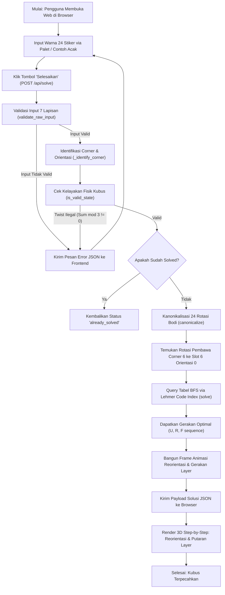
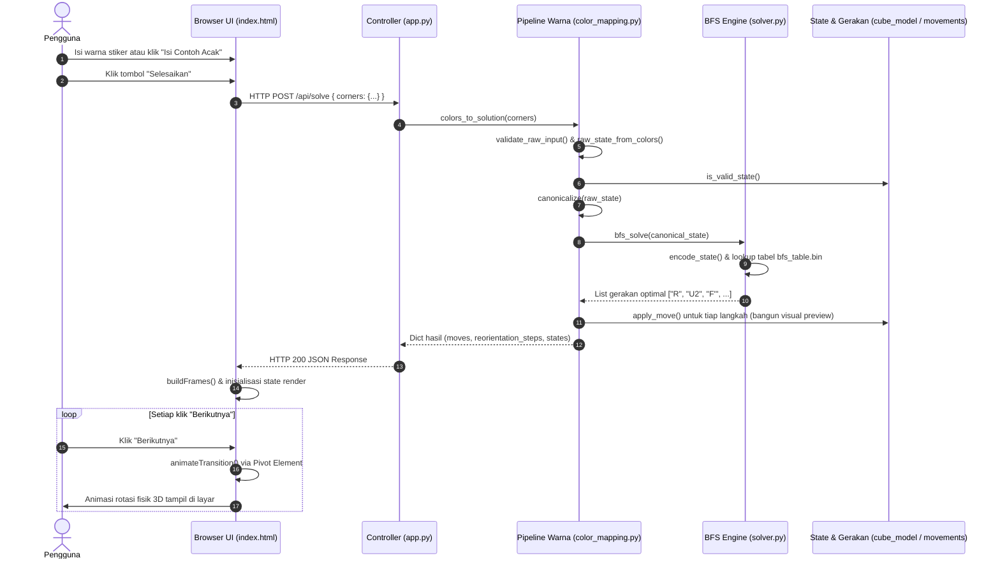

# Pocket Cube (Rubik 2x2x2) Solver

> **Tugas Kelompok Akhir Semester**
> **Mata Kuliah:** Kecerdasan Buatan / Teori Graf / Desain & Analisis Algoritma
> **Aplikasi:** Sistem Pemecah Kubus Rubik 2x2x2 Berbasis *Breadth-First Search* (BFS), *Lehmer Code Encoding*, dan Visualisasi Interaktif Web 3D (Flask + Modern CSS 3D Transforms).

---

## Daftar Isi

1. [Latar Belakang &amp; Ringkasan Proyek](#-latar-belakang--ringkasan-proyek)
2. [Fitur Unggulan Sistem](#-fitur-unggulan-sistem)
3. [Arsitektur Sistem &amp; Alur Kerja](#-arsitektur-sistem--alur-kerja)
4. [Struktur Direktori Proyek](#-struktur-direktori-proyek)
5. [Pemetaan Fungsi &amp; Kode Lengkap (Code Map)](#-pemetaan-fungsi--kode-lengkap-code-map)
   - [cube_model.py](#1-cube_modelpy--model-data-dan-validasi-fisik)
   - [movements.py](#2-movementspy--aljabar-dan-tabel-gerakan-layer)
   - [solver.py](#3-solverpy--engine-bfs-lehmer-code-dan-tabel-lookup)
   - [color_mapping.py](#4-color_mappingpy--pipeline-warna-dan-kanonikalisasi-24-rotasi)
   - [app.py](#5-apppy--web-controller-flask-rest-api)
   - [templates/index.html](#6-templatesindexhtml--antarmuka-dan-mesin-animasi-3d-css)
   - [test_solver.py &amp; test_color_mapping.py](#7-test_solverpy--test_color_mappingpy--unit-testing-suite)
6. [Landasan Teori &amp; Algoritma Matematis](#-landasan-teori--algoritma-matematis)
   - [1. Reduksi Ruang Keadaan (State Space Reduction)](#1-reduksi-ruang-keadaan-state-space-reduction)
   - [2. Pengkodean State via Lehmer Code &amp; Trit-Encoding](#2-pengkodean-state-via-lehmer-code--trit-encoding)
   - [3. Pencarian Jalur Optimal via BFS (God&#39;s Number)](#3-pencarian-jalur-optimal-via-bfs-gods-number)
   - [4. Teori Grup: 24 Rotasi Bodi Kaku (Chiral Octahedral Group)](#4-teori-grup-24-rotasi-bodi-kaku-chiral-octahedral-group)
   - [5. Konvensi Kociemba &amp; Rumus Orientasi Stiker](#5-konvensi-kociemba--rumus-orientasi-stiker)
   - [6. Solusi Mekanika Animasi 3D CSS: Pola Pivot Element](#6-solusi-mekanika-animasi-3d-css-pola-pivot-element)
7. [Panduan Instalasi &amp; Menjalankan Proyek](#-panduan-instalasi--menjalankan-proyek)
8. [Panduan Penggunaan Aplikasi (User Manual)](#-panduan-penggunaan-aplikasi-user-manual)
9. [Dokumentasi Perbaikan Bug &amp; Edge Cases](#-dokumentasi-perbaikan-bug--edge-cases)
10. [Kesimpulan](#-kesimpulan)

---

## Latar Belakang & Ringkasan Proyek

Kubus Rubik 2x2x2 (*Pocket Cube* atau *Mini Cube*) merupakan teka-teki kombinatorial 3D yang hanya terdiri dari **8 buah sudut (corner cubies)** tanpa memiliki bagian tepi (*edges*) maupun pusat muka yang tetap (*fixed centers*). Walaupun terlihat sederhana dibandingkan Rubik 3x3x3, kubus 2x2x2 memiliki **88.179.840** kemungkinan susunan fisik acak.

Tujuan utama dari proyek tugas akhir semester ini adalah merancang dan mengimplementasikan sistem komputasi cerdas yang mampu:

1. **Menerima input warna sembarang** dari kubus fisik pengguna melalui antarmuka web 3D interaktif.
2. **Memvalidasi integritas fisik kubus** secara matematis (mencegah kondisi kubus ilegal akibat stiker tertukar atau kesalahan bongkar-pasang).
3. **Melakukan kanonikalisasi orientasi spasial** kubus menggunakan representasi grup rotasi oktahedral ($O \cong S_4$) sehingga pengguna bebas memegang kubus dalam sudut mana pun saat input.
4. **Menemukan solusi langkah terpendek yang dijamin optimal (God's Algorithm)** dengan jumlah putaran maksimum $\le 11$ gerakan (*Half-Turn Metric* / HTM) secara instan ($< 1$ milidetik) melalui tabel *precomputed lookup* berbasis *Breadth-First Search* (BFS) dan *Lehmer Code*.
5. **Memvisualisasikan solusi langkah demi langkah secara nyata dalam ruang 3D** menggunakan animasi layer berbasis *CSS 3D Transforms* dengan sistem *Pivot Element* yang presisi tanpa ketergantungan library eksternal (seperti Three.js).

---

## Fitur Unggulan Sistem

- **Penyelesaian Instan & Optimal (God's Number):** Solusi selalu memiliki jumlah gerakan paling sedikit yang mungkin dicapai secara matematis (maksimal 11 gerakan HTM).
- **Kompresi Memori Sangat Efisien (~3.5 MB):** Menggunakan pengkodean permutasi Lehmer Code dan orientasi basis-3, seluruh ruang keadaan 3.674.160 state dipadatkan menjadi berkas biner tabel BFS sebesar 3,5 MB (1 byte per state), menghemat memori dibandingkan tabel berbasis dictionary yang dapat melebihi 1 GB.
- **Orientasi Pegang Bebas (24-Way Auto-Canonicalization):** Pengguna tidak perlu khawatir kubus terbalik saat diinput; algoritma secara otomatis mencari jalur reorientasi kubus utuh yang tepat.
- **Antarmuka 3D Web Modern & Ringan:** Dibuat menggunakan HTML5, CSS 3D Transforms, dan JavaScript murni tanpa library grafis berat.
- **Animasi Step-by-Step Interaktif:** Dilengkapi kontrol langkah "Berikutnya" dan "Sebelumnya" dengan animasi putaran lapisan fisik yang mulus mengitari pusat kubus.
- **Validasi 7 Lapis Kesalahan Input:** Sistem mendeteksi secara dini kesalahan kombinasi warna yang mustahil secara fisik (misal: warna berlawanan di satu sudut, warna ganda, atau twist ilegal).
- **Pengujian Menyeluruh (55 Unit Tests):** Seluruh modul backend diuji tuntas menggunakan `unittest` dengan tingkat kelulusan 100%.

---

## Arsitektur Sistem & Alur Kerja

Sistem dibangun dengan arsitektur modular yang memisahkan model data, matematika gerakan, engine pencarian BFS, pipeline pengenalan warna, pengontrol HTTP Flask, dan visualizer web 3D.

### Diagram Alur Kerja Sistem (Flowchart)



### Diagram Interaksi Komponen (Sequence Diagram)



---

## Struktur Direktori Proyek

```text
Rubik_2x2/
├── app.py                     # Controller utama aplikasi web (Flask REST API)
├── cube_model.py              # Definisi model data CubeState & validasi fisik kubus
├── movements.py               # Logika aljabar 9 gerakan layer (U, R, F)
├── solver.py                  # Engine pemecah BFS, Lehmer Code encoding, & tabel binary
├── color_mapping.py           # Pipeline konversi warna, grup 24 rotasi, & kanonikalisasi
├── bfs_table.bin              # Tabel lookup BFS terkompresi 1-byte per state (~3.5 MB)
├── templates/
│   └── index.html             # Tampilan antarmuka web lengkap + CSS 3D + JS Animasi
├── test_solver.py             # Unit test model kubus, gerakan, dan pencarian BFS
├── test_color_mapping.py      # Unit test grup rotasi 24, pemetaan warna, & pipeline
├── docs/                      # Laporan dokumentasi perbaikan internal
│   └── 2026-10-04_color_jump_bugfix.md
├── PERBAIKAN.md               # Catatan detail perbaikan bug historis
├── ref/                       # Berkas referensi multimedia
│   └── cube.mp4
└── README.md                  # Dokumentasi komprehensif proyek
```

---

## Pemetaan Fungsi & Kode Lengkap (Code Map)

Bagian ini merinci fungsi, kelas, konstanta, dan letak baris dari setiap komponen kode pada proyek ini.

### 1. `cube_model.py` — Model Data dan Validasi Fisik

Berkas ini bertanggung jawab atas pemodelan representasi kubus pada tingkat paling fundamental: permutasi dan orientasi corner.

| Simbol / Fungsi                  |            Tipe            | Penjelasan & Peran dalam Sistem                                                                                                                                                                                                                                                                                                                           |
| :------------------------------- | :-------------------------: | :-------------------------------------------------------------------------------------------------------------------------------------------------------------------------------------------------------------------------------------------------------------------------------------------------------------------------------------------------------- |
| `CORNER_NAMES`                 |       `Tuple[str]`       | Berisi 8 nama slot corner: `("URF", "UFL", "ULB", "UBR", "DFR", "DLF", "DBL", "DRB")` mengacu pada konvensi standar Kociemba.                                                                                                                                                                                                                           |
| `CORNER_FACES`                 |    `Dict[int, Tuple]`    | Pemetaan indeks slot ke 3 muka stikernya dengan urutan: muka U/D terlebih dahulu, lalu dua muka lainnya berlawanan jarum jam dilihat dari luar sudut tersebut.                                                                                                                                                                                            |
| `DEFAULT_FACE_COLORS`          |     `Dict[str, str]`     | Skema warna standar Western: `U: White`, `D: Yellow`, `F: Green`, `B: Blue`, `L: Orange`, `R: Red`.                                                                                                                                                                                                                                           |
| `SOLVED_PERM`                  |       `Tuple[int]`       | Permutasi solved: `(0, 1, 2, 3, 4, 5, 6, 7)`.                                                                                                                                                                                                                                                                                                           |
| `SOLVED_ORIENT`                |       `Tuple[int]`       | Orientasi solved: `(0, 0, 0, 0, 0, 0, 0, 0)`.                                                                                                                                                                                                                                                                                                           |
| `CubeState`                    | `@dataclass(frozen=True)` | Struktur data *immutable* yang menyimpan `perm` dan `orient`. Sifat *frozen* dan penggunaan *tuple* memastikan objek ini *hashable* dan aman digunakan sebagai kunci kamus/antrean BFS tanpa risiko termutasi tidak sengaja.                                                                                                                  |
| `CubeState.is_solved()`        |           Method           | Memeriksa apakah permutasi dan orientasi state sama persis dengan kondisi solved.                                                                                                                                                                                                                                                                         |
| `CubeState.as_key()`           |           Method           | Mengembalikan pasangan `(self.perm, self.orient)` untuk keperluan hashing.                                                                                                                                                                                                                                                                              |
| `is_valid_state(perm, orient)` |           Fungsi           | Memvalidasi kelayakan fisik kubus nyata: (1) `perm` harus berupa permutasi lengkap angka 0..7, (2) setiap nilai `orient` harus 0, 1, atau 2, dan (3) jumlah seluruh orientasi wajib habis dibagi 3 ($\sum \text{orient} \equiv 0 \pmod 3$). *Catatan: Kubus 2x2x2 tidak memiliki aturan paritas ganjil-genap permutasi karena tidak adanya edge*. |

---

### 2. `movements.py` — Aljabar dan Tabel Gerakan Layer

Berkas ini mengimplementasikan aljabar gerakan lapisan kubus. **Hanya 3 muka yang digunakan: U (Up), R (Right), dan F (Front).**

| Simbol / Fungsi                  |           Tipe           | Penjelasan & Peran dalam Sistem                                                                                                                           |
| :------------------------------- | :----------------------: | :-------------------------------------------------------------------------------------------------------------------------------------------------------- |
| `URF, UFL, ... DRB`            |        Konstanta        | Alias bilangan bulat `0` sampai `7` untuk keterbacaan tabel mutasi gerakan.                                                                           |
| `_BASE_TURNS`                  | `Dict[str, CubeState]` | Tabel kondisi kubus setelah 1 putaran 90° searah jarum jam untuk muka `U`, `R`, dan `F`.                                                           |
| `_apply_table(state, table)`   |     Fungsi Internal     | Menerapkan mutasi tabel pada sebuah state: `perm_baru[i] = perm[table.perm[i]]` dan `orient_baru[i] = (orient[table.perm[i]] + table.orient[i]) % 3`. |
| `_build_moves()`               |     Fungsi Internal     | Menghasilkan tabel untuk seluruh 9 gerakan legal ($X$, $X^2$, $X'$) melalui penggandaan komposisi gerakan dasar.                                    |
| `MOVES`                        | `Dict[str, CubeState]` | Kamus 9 gerakan yang siap diaplikasikan langsung.                                                                                                         |
| `ALL_MOVES`                    |      `Tuple[str]`      | Daftar urutan 9 gerakan: `("U", "U'", "U2", "R", "R'", "R2", "F", "F'", "F2")`.                                                                         |
| `apply_move(state, move)`      |      Fungsi Publik      | Menerapkan satu token gerakan pada `CubeState` dan mengembalikan objek `CubeState` baru.                                                              |
| `parse_moves(sequence)`        |      Fungsi Publik      | Memecah string notasi gerakan (seperti `"R U2 F' R'"`) menjadi daftar token, sekaligus menormalisasi karakter petik Unicode.                            |
| `apply_moves(state, sequence)` |      Fungsi Publik      | Menerapkan rangkaian beberapa gerakan berturut-turut pada state kubus.                                                                                    |
| `inverse_move(move)`           |      Fungsi Publik      | Membalik satu gerakan: $R \leftrightarrow R'$, $R^2 \leftrightarrow R^2$.                                                                             |
| `inverse_moves(sequence)`      |      Fungsi Publik      | Membalik urutan seluruh rangkaian gerakan sekaligus menginvers masing-masing gerakan (misal: `"R U2 F'"` menjadi `"F U2 R'"`).                        |

---

### 3. `solver.py` — Engine BFS, Lehmer Code, dan Tabel Lookup

Berkas ini merupakan inti kecerdasan buatan (*AI Solver*) yang menjamin pencarian rute terpendek (*optimal shortest path*) secara instan.

| Simbol / Fungsi                     |      Tipe      | Penjelasan & Peran dalam Sistem                                                                                                                                                              |
| :---------------------------------- | :-------------: | :------------------------------------------------------------------------------------------------------------------------------------------------------------------------------------------- |
| `FREE_POS`                        | `Tuple[int]` | Daftar 7 slot sudut bebas: `(0, 1, 2, 3, 4, 5, 7)`. Slot 6 (DBL) selalu difiksasi pada posisi 6 orientasi 0.                                                                               |
| `PERM_TABLE_SIZE`                 |    Konstanta    | Nilai $7! = 5.040$, jumlah permutasi 7 corner bebas.                                                                                                                                       |
| `ORIENT_TABLE_SIZE`               |    Konstanta    | Nilai $3^6 = 729$, jumlah kombinasi orientasi 6 corner bebas (corner ke-7 ditentukan oleh hukum modulo 3).                                                                                 |
| `TABLE_SIZE`                      |    Konstanta    | $5.040 \times 729 = 3.674.160$ state total.                                                                                                                                                |
| `_lehmer_encode(ranks)`           | Fungsi Internal | Mengonversi permutasi 7 elemen menjadi integer unik ($0 \dots 5.039$) menggunakan algoritma Lehmer Code (sistem bilangan faktorial).                                                       |
| `_lehmer_decode(code, n)`         | Fungsi Internal | Operasi invers dari Lehmer Code untuk merekonstruksi susunan peringkat dari sebuah integer.                                                                                                  |
| `encode_state(state)`             |  Fungsi Publik  | Memetakan objek `CubeState` lengkap menjadi satu integer unik pada rentang $0 \dots 3.674.159$.                                                                                          |
| `decode_state(index)`             |  Fungsi Publik  | Mengubah kembali integer indeks menjadi objek `CubeState` (digunakan dalam pengujian dan verifikasi integritas).                                                                           |
| `is_encodable(state)`             |  Fungsi Publik  | Gerbang keamanan yang memastikan state valid fisik DAN corner index 6 (DBL) berada tepat pada slot 6 dengan orientasi 0 sebelum dilakukan encode/solve.                                      |
| `build_bfs_table()`               |     Fungsi     | Menjalankan algoritma BFS mundur mulai dari `SOLVED_STATE` menyusuri seluruh 3.674.160 kemungkinan keadaan. Pada setiap state baru, disimpan indeks gerakan invers dari gerakan penemunya. |
| `save_table()` / `load_table()` |   Fungsi I/O   | Menyimpan dan memuat tabel biner array 1-byte (`bfs_table.bin`, ukuran $\approx 3,5$ MB).                                                                                                |
| `get_table()`                     |  Fungsi Publik  | Mengambil tabel dari cache RAM, atau memuatnya dari berkas biner, atau membangunnya secara otomatis jika berkas belum ada.                                                                   |
| `solve(state, table)`             |  Fungsi Publik  | Menyelesaikan kubus secara optimal dengan membaca byte instruksi langkah berikutnya dari tabel secara berulang hingga mencapai solved state (kompleksitas $O(L)$ dengan $L \le 11$).     |
| `solve_to_string(state)`          |  Fungsi Publik  | Memformat hasil `solve()` menjadi representasi string notasi standar.                                                                                                                      |

---

### 4. `color_mapping.py` — Pipeline Warna dan Kanonikalisasi 24 Rotasi

Berkas ini bertugas menjembatani dunia nyata (warna stiker yang dilihat pengguna) dengan dunia abstrak solver matematik (CubeState kanonik).

| Simbol / Fungsi                     |         Tipe         | Penjelasan & Peran dalam Sistem                                                                                                                                                                                   |
| :---------------------------------- | :------------------: | :---------------------------------------------------------------------------------------------------------------------------------------------------------------------------------------------------------------- |
| `ColorMappingError`               |      Exception      | Kelas exception kustom untuk menampilkan pesan kesalahan validasi input yang ramah pengguna.                                                                                                                      |
| `validate_raw_input(corners)`     |    Fungsi Publik    | Melakukan validasi fisik 7 tingkat terhadap input warna 24 stiker pengguna.                                                                                                                                       |
| `_canonical_orders(color_scheme)` |   Fungsi Internal   | Menghasilkan daftar urutan stiker kanonik untuk masing-masing sudut berdasarkan skema warna.                                                                                                                      |
| `_identify_corner(colors, canon)` |   Fungsi Internal   | Mengidentifikasi ID sudut (0..7) dan nilai orientasi (0..2) dari 3 warna stiker yang dibaca. Menggunakan formula `(3 - o) % 3` untuk menyelaraskan arah rotasi warna dengan konvensi Kociemba.                  |
| `raw_state_from_colors(corners)`  |    Fungsi Publik    | Mengonversi input stiker menjadi `CubeState` mentah sebelum dinormalisasi.                                                                                                                                      |
| `CORNER_COORD`                    | `Dict[int, Tuple]` | Koordinat geometri 3D $(\pm 1, \pm 1, \pm 1)$ untuk kedelapan slot sudut di ruang kartesius.                                                                                                                    |
| `_rot_x(v)` / `_rot_y(v)`       |   Fungsi Internal   | Transformasi rotasi 90° matematis pada sumbu X dan Y: $\text{rot}_x(x,y,z) = (x, -z, y)$ dan $\text{rot}_y(x,y,z) = (z, y, -x)$.                                                                             |
| `_generate_rotations()`           |   Fungsi Internal   | Menggunakan BFS pada grup rotasi untuk membangun seluruh 24 matriks rotasi bodi kubus utuh serta mencatat lintasan token rotasi (`x` dan `y`) terpendek untuk animasi reorientasi.                            |
| `ROTATIONS`, `ROTATION_PATHS`   |      Konstanta      | Daftar 24 fungsi rotasi kubus dan lintasan token transformasinya.                                                                                                                                                 |
| `apply_rotation(state, rot_fn)`   |    Fungsi Publik    | Merotasi seluruh kubus di ruang 3D tanpa memutar layer individu (meniru memutar kubus di tangan).                                                                                                                 |
| `canonicalize(raw_state)`         |    Fungsi Publik    | Menguji 24 rotasi ruang dan menemukan satu-satunya rotasi yang membawa corner ID 6 (DBL) ke slot 6 dengan orientasi 0.                                                                                            |
| `state_to_colors(state)`          |    Fungsi Publik    | Kebalikan dari pembacaan: mengubah `CubeState` menjadi pemetaan warna stiker per slot.                                                                                                                          |
| `colors_to_solution(corners)`     |     Fungsi Utama     | Menjalankan seluruh pipeline: validasi input $\rightarrow$ identifikasi $\rightarrow$ kanonikalisasi $\rightarrow$ pencarian BFS $\rightarrow$ pembuatan frame transisi warna untuk visualisasi frontend. |

---

### 5. `app.py` — Web Controller (Flask REST API)

Berkas ini merupakan pengendali HTTP yang menghubungkan antarmuka browser dengan engine komputasi Python.

| Route / Fungsi    |        Metode        | Penjelasan & Peran dalam Sistem                                                                                                                                  |
| :---------------- | :------------------: | :--------------------------------------------------------------------------------------------------------------------------------------------------------------- |
| `index()`       |      `GET /`      | Merender dan menyajikan halaman web visualizer (`templates/index.html`).                                                                                       |
| `api_solve()`   | `POST /api/solve` | Endpoint API untuk menerima payload JSON berisi 24 warna stiker sudut, memanggil `colors_to_solution()`, dan mengembalikan solusi langkah serta frame animasi. |
| `api_example()` | `GET /api/example` | Endpoint API untuk menghasilkan acakan kubus acak yang dijamin valid secara fisik dan disimulasikan dipegang pada orientasi acak.                                |

---

### 6. `templates/index.html` — Antarmuka dan Mesin Animasi 3D CSS

Berkas tunggal ini mencakup struktur HTML5, styling CSS modern dengan ruang 3D, dan logika JavaScript interaktif.

| Bagian / Komponen              |    Tipe    | Penjelasan & Peran dalam Sistem                                                                                                                                                             |
| :----------------------------- | :--------: | :------------------------------------------------------------------------------------------------------------------------------------------------------------------------------------------ |
| `.scene` & `.cube-outer`   |   CSS 3D   | Menentukan perspektif visual (`perspective: 1100px`) dan sudut pandang isometrik awal kubus (`rotateX(-24deg) rotateY(-35deg)`).                                                        |
| `.cube-nav`                  |   CSS 3D   | Elemen pembungkus untuk navigasi kamera pengguna (memungkinkan melihat sisi belakang/bawah kubus).                                                                                          |
| `.cube-inner`                |   CSS 3D   | Poros ruang kubus tempat ke-8 cubie berada.                                                                                                                                                 |
| `.cubie` & `.cubie-face`   |   CSS 3D   | Elemen fisik cubie dan plat stiker yang dapat diklik untuk memilih warna.                                                                                                                   |
| `.cubie-core`                |   CSS 3D   | Plat inti hitam pada 3 sisi bagian dalam cubie untuk mencegah tembus pandang saat lapisan terbuka/berputar.                                                                                 |
| `.layer-pivot`               |   CSS 3D   | Elemen pivot dinamis berukuran $0 \times 0$ di titik $(0,0,0)$ yang digunakan oleh mesin animasi untuk memutar cubie mengelilingi pusat kubus.                                          |
| `copySelections()`           | JavaScript | Melakukan *deep copy* independen terhadap array seleksi warna stiker untuk mencegah *shallow copy reference mutation*.                                                                  |
| `cornerColorsFromStateObj()` | JavaScript | Menyalin objek state warna dari backend tanpa berbagi referensi memori.                                                                                                                     |
| `animateSlots()`             | JavaScript | Inti mesin animasi: memindahkan cubie target ke dalam `.layer-pivot`, menganimasikan rotasi pivot dengan transisi CSS, lalu mengembalikan cubie ke `.cube-inner` dengan posisi barunya. |
| `animateTransition()`        | JavaScript | Menentukan sumbu dan arah sudut animasi berdasarkan tipe transisi (reorientasi seluruh bodi atau putaran layer U, R, F).                                                                    |
| `buildFrames()`              | JavaScript | Membangun urutan frame lengkap (frame 0 = input asli, frame reorientasi jika ada, diikuti frame untuk setiap gerakan solusi).                                                               |
| `goToFrame()`                | JavaScript | Mengatur navigasi langkah ("Berikutnya" / "Sebelumnya") dengan perlindungan terhadap *race conditions* menggunakan `renderGen`.                                                         |

---

### 7. `test_solver.py` & `test_color_mapping.py` — Unit Testing Suite

| Berkas Pengujian          | Jumlah Test | Fokus Pengujian                                                                                                                                                                                     |
| :------------------------ | :---------: | :-------------------------------------------------------------------------------------------------------------------------------------------------------------------------------------------------- |
| `test_solver.py`        |  36 Tests  | Menguji validitas model `CubeState`, aljabar gerakan `apply_move` & inversi, konsistensi Lehmer Code, roundtrip encoding-decoding, serta optimalitas pencarian solusi BFS.                      |
| `test_color_mapping.py` |  19 Tests  | Menguji sifat 24 rotasi ruang kubus (ketunggalan, ketertutupan, transitivitas), identifikasi warna stiker, validasi 7 lapis error, kanonikalisasi orientasi sembarang, dan roundtrip solving penuh. |

---

## Landasan Teori & Algoritma Matematis

### 1. Reduksi Ruang Keadaan (State Space Reduction)

Pada kubus Rubik 3x3x3, terdapat 6 center pieces yang posisinya terkunci terhadap satu sama lain, sehingga orientasi spasial kubus otomatis terjaga. Namun, pada kubus 2x2x2 **tidak ada satu pun center piece**.

Jika kita memutar seluruh 6 muka ($U, D, L, R, F, B$), jumlah seluruh keadaan yang bisa dijumpai adalah:

$$
\text{Total Posisi Fisik} = 8! \times 3^7 = 88.179.840
$$

*(Faktor $3^7$ muncul karena orientasi 7 sudut bebas menentukan orientasi sudut ke-8).*

Namun, memutar muka $D$ (bawah) sebenarnya ekuivalen dengan memutar muka $U$ (atas) lalu memutar orientasi seluruh kubus di tangan. Oleh karena itu, kita dapat **memfiksasi satu corner cubie sebagai patokan acuan**. Pada sistem ini, sudut **DBL (Down-Back-Left / indeks 6)** dipilih sebagai sudut acuan yang posisinya tidak pernah digerakkan.

Dengan hanya memperbolehkan 3 muka yang diputar, yaitu:

$$
\text{Gerakan Legal} \in \{U, R, F\}
$$

maka sudut DBL tidak akan pernah berpindah atau berputar. Konsekuensinya:

- Permutasi sudut yang tersisa: $7! = 5.040$
- Orientasi sudut yang tersisa: $3^6 = 729$ (karena sudut ke-6 diam berorientasi 0, dan sudut ke-7 terkunci oleh hukum modulo 3).

Ukuran ruang pencarian tereduksi drastis menjadi:

$$
\text{State Space Terfiksasi} = 7! \times 3^6 = 5.040 \times 729 = \mathbf{3.674.160}
$$

Ukuran ini persis $\frac{88.179.840}{24} = 3.674.160$, di mana angka 24 merupakan jumlah orientasi fisik kubus di ruang 3D.

---

### 2. Pengkodean State via Lehmer Code & Trit-Encoding

Untuk menyimpan seluruh 3.674.160 state di dalam memori tanpa pemborosan RAM, setiap keadaan kubus dipetakan secara bijektif (*one-to-one and onto*) ke sebuah bilangan bulat $I \in [0, 3.674.159]$.

#### A. Lehmer Code untuk Permutasi 7 Elemen ($0 \dots 5.039$)

Permutasi dari 7 posisi bebas dikodekan menggunakan sistem bilangan faktorial (*factoradic system*):

$$
L(\pi) = \sum_{i=0}^{n-1} c_i \times (n - 1 - i)!
$$

di mana $c_i$ adalah banyaknya elemen di sebelah kanan posisi $i$ yang memiliki nilai lebih kecil dari $\pi[i]$. Nilai ini menghasilkan indeks integer tunggal $0 \le \text{perm\_code} < 5.040$.

#### B. Trit-Encoding untuk Orientasi ($0 \dots 728$)

Enam nilai orientasi sudut bebas ($o_0, o_1, o_2, o_3, o_4, o_5 \in \{0, 1, 2\}$) dikodekan sebagai bilangan basis-3:

$$
\text{orient\_code} = \sum_{i=0}^{5} o_i \times 3^{5-i}
$$

Nilai ini menghasilkan bilangan bulat $0 \le \text{orient\_code} < 729$.

#### C. Indeks Tabel Gabungan

Indeks akhir dihitung dengan menggabungkan kedua kode:

$$
\text{Index} = (\text{perm\_code} \times 729) + \text{orient\_code}
$$

Dengan teknik ini, seluruh tabel BFS dapat direpresentasikan sebagai sebuah array biner sederhana bertipe *signed 8-bit integer* (`int8`):

$$
\text{Ukuran Berkas} = 3.674.160 \times 1 \text{ byte} \approx \mathbf{3,504 \text{ MB}}
$$

---

### 3. Pencarian Jalur Optimal via BFS (God's Number)

Untuk menjamin bahwa solusi yang dihasilkan selalu memiliki jumlah langkah paling sedikit (*optimal shortest path*), sistem menggunakan algoritma **Breadth-First Search (BFS)** yang dijalankan secara mundur (*reverse BFS*):

1. BFS dimulai dari satu titik asal: `SOLVED_STATE`.
2. Dari antrean state saat ini, diterapkan seluruh 9 kemungkinan gerakan $m \in \{U, U', U^2, R, R', R^2, F, F', F^2\}$.
3. Untuk setiap state baru $S_{\text{baru}}$ yang belum pernah dikunjungi, disimpan **gerakan invers** $m^{-1}$ pada tabel:
   $$
   \text{table}[\text{encode}(S_{\text{baru}})] = \text{index}(m^{-1})
   $$
4. Karena BFS menyisir graf keadaan lapis demi lapis berdasarkan kedalaman jarak (*depth-by-depth*), gerakan pertama yang mencapai suatu state dijamin merupakan rute terpendek menuju kondisi solved.

#### Karakteristik Ruang Keadaan (God's Number 2x2x2)

Tabel berikut menunjukkan distribusi jumlah gerakan optimal pada kubus 2x2x2 dalam metrik *Half-Turn Metric* (HTM):

| Jarak (Kedalaman BFS) |    Jumlah State    | Keterangan                             |
| :-------------------: | :-----------------: | :------------------------------------- |
|           0           |          1          | Posisi Solved                          |
|           1           |          9          | 1 gerakan dari solved                  |
|           2           |         54         | 2 gerakan                              |
|           3           |         321         |                                        |
|           4           |        1.847        |                                        |
|           5           |        9.997        |                                        |
|           6           |       50.136       |                                        |
|           7           |       217.332       |                                        |
|           8           |       733.956       |                                        |
|           9           |      1.378.100      | Kedalaman dengan state terbanyak       |
|          10          |      1.253.945      |                                        |
|          11          |       28.462       | **God's Number** (Jarak terjauh) |
|    **Total**    | **3.674.160** | **100% State Space Terjangkau**  |

*Kesimpulan Matematis: Tidak ada satu pun susunan kubus 2x2x2 di dunia ini yang membutuhkan lebih dari 11 gerakan untuk diselesaikan.*

---

### 4. Teori Grup: 24 Rotasi Bodi Kaku (Chiral Octahedral Group)

Karena solver mengasumsikan corner DBL berada di slot 6 orientasi 0, kubus nyata yang diinput oleh pengguna hampir pasti tidak langsung memenuhi kondisi tersebut.

Berdasarkan teori aljabar abstrak, kelompok rotasi simetri kubus kaku dalam ruang 3 dimensi (tanpa refleksi cermin) membentuk grup kiralitas oktahedral:

$$
O \cong S_4, \quad |O| = 24
$$

Grup ini bertindak secara transitif pada 8 sudut kubus dengan *stabilizer* berordo 3 pada setiap sudut ($8 \times 3 = 24$). Artinya:

> **Teorema:** *Untuk posisi acak mana pun dari kubus 2x2x2, terdapat TEPAT SATU dari 24 rotasi ruang bodi kubus yang akan membawa sudut patokan (DBL) ke slot 6 dengan orientasi 0.*

Pada `color_mapping.py`, ke-24 rotasi ini dibangun melalui penelusuran BFS dari dua operasi rotasi ortogonal 90°:

- $\text{rot}_x(x,y,z) = (x, -z, y)$
- $\text{rot}_y(x,y,z) = (z, y, -x)$

Selain menemukan rotasi kanonik, algoritma ini juga mencatat **lintasan token gerakan terpendek** (misal: `['x', 'y']`) yang langsung diterjemahkan menjadi animasi reorientasi bodi kubus di antarmuka pengguna.

---

### 5. Konvensi Kociemba & Rumus Orientasi Stiker

Dalam konvensi representasi Kociemba pada kubus Rubik:

- Orientasi 0 berarti stiker muka $U$ atau $D$ berada pada muka $U$ atau $D$.
- Orientasi 1 berarti stiker tersebut berputar searah jarum jam (*clockwise*).
- Orientasi 2 berarti stiker tersebut berputar berlawanan jarum jam (*counter-clockwise*).

Ketika kita membaca warna stiker fisik dari luar kubus untuk mengidentifikasi nilai orientasi numerik piece tersebut, arah pemetaan mengalami pembalikan (*inversion*). Oleh karena itu, jika urutan stiker kanonik terotasi sebanyak $o$ langkah siklik, orientasi piece yang sebenarnya dihitung dengan rumus:

$$
\text{Orientasi} = (3 - o) \pmod 3
$$

Formula ini menyelesaikan masalah klasik *color jump* di mana warna stiker tampak melompat atau terpelintir secara keliru setelah lapisan diputar.

---

### 6. Solusi Mekanika Animasi 3D CSS: Pola Pivot Element

Pada implementasi grafis 3D web tanpa menggunakan canvas WebGL/Three.js, setiap cubie diposisikan dalam ruang koordinat menggunakan CSS transform:

```css
transform: translate3d(x * OFFSET, -y * OFFSET, z * OFFSET);
```

#### Masalah Evaluasi Transform String CSS

Jika kita mencoba memutar lapisan kubus dengan menggabungkan string transform:

```js
// KODE LAMA BERMASALAH:
el.style.transform = `rotateY(90deg) ${el.dataset.base}`;
```

Dalam spesifikasi CSS, operasi matriks transform dievaluasi **dari kanan ke kiri**. Akibatnya, elemen cubie pertama-tama di-translate ke posisinya di pojok, lalu dirotasikan terhadap titik lokal cubie itu sendiri. Hasilnya, cubie melompat keluar dari kubus dan terbang pada poros yang salah.

#### Solusi Arsitektur: Pivot Element Pattern

Untuk menyelesaikan masalah ini, dirancang pola **Pivot Element**:

1. Sebuah elemen pembungkus sementara (`div.layer-pivot`) dibuat tepat di tengah kubus dengan ukuran $0 \times 0$ pada posisi `left: 50%; top: 50%`.
2. Empat cubie yang termasuk dalam lapisan yang akan diputar dipindahkan sementara dari `.cube-inner` menjadi *child node* dari `.layer-pivot`.
3. Elemen pivot kemudian dirotasikan secara mulus menggunakan CSS Transition:
   ```css
   pivot.style.transform = `rotateY(-90deg)`;
   ```
4. Karena pivot berada tepat di pusat koordinat kubus $(0,0,0)$, seluruh cubie di dalamnya berputar secara presisi mengelilingi sumbu pusat kubus.
5. Setelah animasi selesai, cubie dikembalikan ke `.cube-inner`, posisinya di-*snap* ke koordinat baru, dan warna stiker diperbarui sesuai state berikutnya.

---

## Panduan Instalasi & Menjalankan Proyek

### Prasyarat Sistem

- **Python:** Versi 3.8 atau yang lebih baru.
- **Pip:** Package installer untuk Python.
- **Web Browser:** Google Chrome, Mozilla Firefox, Microsoft Edge, atau browser modern lainnya yang mendukung CSS 3D Transforms.

### 1. Clone atau Ekstrak Proyek

Buka terminal dan navigasikan ke direktori proyek:

```bash
cd "Rubik_2x2 (2)"
```

### 2. (Opsional) Buat Virtual Environment

Disarankan menggunakan virtual environment agar dependensi terisolasi:

```bash
python3 -m venv venv
source venv/bin/activate
```

### 3. Instalasi Dependensi

Proyek ini sengaja dirancang sangat efisien dengan dependensi minimal. Satu-satunya pustaka eksternal yang dibutuhkan adalah **Flask**:

```bash
pip install Flask
```

### 4. Menjalankan Server Aplikasi

Jalankan file `app.py`:

```bash
python3 app.py
```

Output terminal akan menampilkan konfirmasi bahwa server telah aktif:

```text
 * Serving Flask app 'app'
 * Debug mode: on
 * Running on http://127.0.0.1:5000
Press CTRL+C to quit
```

### 5. Membuka Aplikasi

Buka peramban web (browser) favorit Anda dan akses URL:

```text
http://127.0.0.1:5000
```

---

## Panduan Menjalankan Pengujian (Unit Tests)

Seluruh logika matematika, representasi data, pencarian BFS, dan kanonikalisasi telah dilengkapi dengan pengujian komprehensif.

Jalankan test suite menggunakan modul bawaan Python:

```bash
python3 -m unittest discover -v
```

Hasil pengujian akan menampilkan 55 test yang seluruhnya berstatus **OK**:

```text
test_exactly_24_unique_rotations (test_color_mapping.TestRotationGroup) ... ok
test_transitivity_every_slot_orient_has_exactly_one_rotation (test_color_mapping.TestRotationGroup) ... ok
test_validate_raw_input_valid (test_color_mapping.TestColorMappingPipeline) ... ok
test_canonicalize_normalizes_to_slot6_orient0 (test_color_mapping.TestColorMappingPipeline) ... ok
test_full_pipeline_random_scrambles (test_color_mapping.TestColorMappingPipeline) ... ok
test_solved_state_is_solved (test_solver.TestCubeModel) ... ok
test_bfs_solves_all_depth_1_states (test_solver.TestSolverBFSTable) ... ok
test_solver_finds_optimal_solutions (test_solver.TestSolverBFSTable) ... ok
...
----------------------------------------------------------------------
Ran 55 tests in 0.742s

OK
```

---

## Panduan Penggunaan Aplikasi (User Manual)

Antarmuka web dirancang agar mudah digunakan bahkan oleh orang yang belum pernah bermain Rubik sebelumnya.

### 1. Memasukkan Warna Kubus (Mode Input)

Terdapat dua cara untuk memasukkan kondisi acak kubus:

- **Cara A: Memasukkan Warna Manual Sesuai Kubus Nyata**

  1. Klik salah satu tombol warna pada **Palet Warna** di bagian atas (Putih, Kuning, Hijau, Biru, Oranye, Merah).
  2. Klik stiker pada model kubus 3D untuk mewarnainya.
  3. Gunakan tombol panah navigasi **Panah Kiri (←)**, **Panah Kanan (→)**, dan **Panah Atas (↑)** untuk memutar sudut pandang kamera kubus sehingga Anda dapat menjangkau seluruh 6 sisi (total 24 stiker).
  4. Perhatikan indikator di bawah kubus: `24/24 stiker terisi`.
- **Cara B: Mengisi Contoh Acak Otomatis (Instan)**

  1. Klik tombol **"Isi Contoh Acak"**.
  2. Sistem akan menghasilkan konfigurasi acak yang dijamin valid secara fisik dan langsung merendernya pada kubus 3D.

### 2. Memulai Pencarian Solusi

1. Klik tombol utama **"Selesaikan"**.
2. Jika input stiker belum lengkap atau kombinasi warna tidak valid secara fisik, kotak pesan merah akan muncul dengan penjelasan detail kesalahannya.
3. Jika konfigurasi valid, solver akan menghitung solusi dalam hitungan milidetik dan menampilkan:
   - Deretan notasi langkah optimal (misal: `R`, `U2`, `F'`).
   - Jumlah langkah minimum yang dibutuhkan.
   - Panel kendali langkah animasi: **"Sebelumnya"**, **"Berikutnya"**, dan indikator langkah `X / Total`.

### 3. Mengikuti Animasi Langkah demi Langkah (Mode Preview)

1. **Langkah Reorientasi (Jika Dibutuhkan):**Jika sudut awal kubus tidak sejajar dengan orientasi solver, langkah pertama akan berupa instruksi:*"Putar SELURUH kubus supaya sejajar dengan posisi acuan solver."*Klik **"Berikutnya"**, dan seluruh kubus akan berputar secara otomatis di layar.
2. **Langkah Gerakan Lapisan:**Setiap klik **"Berikutnya"**, lapisan kubus yang bersangkutan ($U, R,$ atau $F$) akan berputar secara fisik dalam ruang 3D disertai teks penjelasan bahasa Indonesia (misal: *"Putar lapisan Atas (U) 90° searah jarum jam"*).
3. Anda dapat menekan **"Sebelumnya"** kapan saja untuk memutar mundur langkah solusi.
4. Ketika langkah terakhir selesai, kubus akan berada dalam kondisi **solved sempurna (seluruh sisi satu warna)**.

### 4. Mengulang Kembali

Klik tombol **"Reset"** untuk mengosongkan stiker kubus dan kembali ke mode input awal.

---

## Dokumentasi Perbaikan Bug & Edge Cases

Selama proses pengembangan sistem, sejumlah tantangan teknis diselesaikan dan didokumentasikan sebagai bagian dari pembelajaran rekayasa perangkat lunak:

### 1. Masalah Shallow Copy pada State JavaScript

- **Gejala:** Saat berpindah langkah animasi, warna kubus pada frame awal berubah secara tidak terduga setelah tombol reset ditekan.
- **Penyebab:** Penggunaan *spread operator* `{ ...selections }` hanya menyalin objek tingkat pertama, sementara *array* 3 warna di dalamnya tetap berbagi referensi memori yang sama.
- **Solusi:** Diimplementasikan fungsi `copySelections()` dan `cornerColorsFromStateObj()` yang melakukan *deep clone* rekursif pada setiap array warna per slot sudut.

### 2. Masalah Anomali Poros Animasi CSS 3D

- **Gejala:** Cubie terlempar keluar kubus (*flying cubie bug*) saat lapisan berputar.
- **Penyebab:** Urutan evaluasi transformasi CSS mengevaluasi translasi terlebih dahulu sebelum rotasi sudut lokal cubie.
- **Solusi:** Diterapkan arsitektur **Pivot Element** (`.layer-pivot`) di pusat kubus $(0,0,0)$ sebagai kontainer dinamis selama proses transisi.

### 3. Masalah Sinkronisasi Arah Sumbu Reorientasi

- **Gejala:** Kubus berputar ke arah yang berlawanan saat menganimasikan reorientasi seluruh bodi pada sumbu Y.
- **Penyebab:** Fungsi rotasi sumbu Y pada Python (`_rot_y`) bernilai geometris $-90^\circ$ pada sistem koordinat CSS browser.
- **Solusi:** Dibuat pemetaan eksplisit `REORIENT_AXIS_ANGLE = { x: { axis: 'X', angle: 90 }, y: { axis: 'Y', angle: -90 } }`.

### 4. Masalah *Color Jump* Akibat Konvensi Kociemba

- **Gejala:** Warna stiker tampak melompat atau terpelintir secara keliru tepat setelah animasi putaran lapisan selesai.
- **Penyebab:** Pembacaan orientasi stiker membaca indeks secara searah jarum jam, padahal definisi twist matematis Kociemba bekerja secara berlawanan pada muka observasi.
- **Solusi:** Diterapkan transformasi modulo `(3 - o) % 3` pada pembacaan stiker di `_identify_corner()` dan `state_to_colors()`.

### 5. Masalah Tembus Pandang Bagian Dalam Cubie

- **Gejala:** Saat lapisan diputar, bagian belakang stiker cubie lain terlihat karena cubie hanya memiliki 3 pelat stiker luar.
- **Penyebab:** Sisi bagian dalam cubie kosong (bolong).
- **Solusi:** Ditambahkan 3 pelat inti hitam (`.cubie-core`) pada sisi-sisi internal setiap cubie sehingga lapisan tampak padat dan pekat layaknya kubus fisik asli.

---

## Kesimpulan

Proyek **Pocket Cube (Rubik 2x2x2) Solver** ini berhasil mengintegrasikan teori matematika murni (aljabar abstrak, teori grup, dan teori graf) dengan rekayasa perangkat lunak modern (Python Flask, kompresi memori, dan visualisasi web 3D). Melalui pemanfaatan reduksi simetri ruang keadaan dan pengkodean Lehmer Code, sistem ini mampu membuktikan secara empiris dan komputasional konsep **God's Number ($\le 11$ gerakan)** serta menyajikannya dalam antarmuka web interaktif yang edukatif, efisien, dan andal.

---

*Dibuat dengan dedikasi untuk penyelesaian Tugas Kelompok Akhir Semester.*